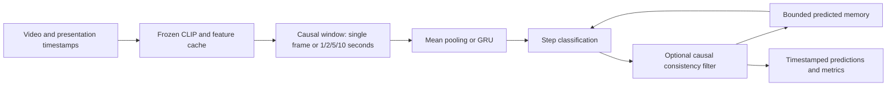

# How Much Context Is Enough?

A research framework for evaluating temporal and procedural memory for egocentric step recognition, inspired by Pro?Assist rather than reproducing its full system.

The questions are: how much visual context helps; whether predicted procedural history helps; and whether shorter windows with memory preserve accuracy while reducing cost. H1?H4 (longer context helps up to diminishing returns, memory resolves ambiguity, memory compensates for shorter context, and deviations can hurt procedural assumptions) remain untested on real data.



## Setup on Windows / PowerShell

Python 3.11 is the tested interpreter. Install a PyTorch build suitable for your device using the official selector at https://pytorch.org/get-started/locally/; CPU works for software checks. Dependencies use version ranges because an exact GPU environment has not been validated here.

```powershell
conda create -n pcw python=3.11 pip
conda activate pcw
python -m pip install -e ".[dev,vision]"
python -m pytest -q
pcw synthetic
pcw matrix --epochs 2
pcw figures
pcw report
```

The default CPU matrix uses synthetic **feature fixtures**, not videos. Its metrics and figures validate software and cannot support computer vision findings. `results/matrix.json` contains all 13 conditions; each unique run directory contains its complete configuration, exact splits, cache hashes, checkpoint, normalization, procedure, per-video metrics and timestamped predictions. UUID suffixes prevent run collisions. Matrix decoding is fixed to no smoothing.

Without installing the package, use `$env:PYTHONPATH="src"` and replace `pcw` with `python -m pcw.cli`. In this session pytest was downloaded into `.test-deps`; see docs/status.md for the exact tested environment.

## Connect real annotated video

Read [dataset requirements](docs/datasets.md) first. EgoPER is prioritized, but data access is gated and its actual annotation distribution is absent here. No speculative EgoPER loader is provided. Implement conversion only after inspecting the authorized distribution. Generic preparation accepts the normalized JSON format below, validates it and creates participant-disjoint splits (video-disjoint when participant information is incomplete).

```json
[{"video_id":"example","participant_id":"person_01","procedure_id":"task","video_path":"videos/example.mp4","duration_seconds":12.0,"segments":[{"start":0.0,"end":4.0,"step_id":0}]}]
```

A procedure JSON contains `procedure_id`, `steps` with contiguous integer `id` and `name`, and optional directed `transitions` pairs. Paths resolve relative to the input manifest. Supply at least three independent participant/video groups. Each run currently covers one procedure.

```powershell
python scripts/inspect_dataset.py --input data/raw/authorized_annotations.json
pcw prepare --input data/raw/normalized.json --procedure data/raw/procedure.json --data data/processed/real
pcw extract --data data/processed/real --config configs/default.yaml --device auto --batch-size 32
pcw train --data data/processed/real --window 0 --memory none --output results/real
pcw matrix --data data/processed/real --output results/real --config configs/default.yaml
pcw figures --input results/real/matrix.json --output results/real
```

CLIP extraction explicitly downloads public model weights through Hugging Face and needs no proprietary credentials. Tests never construct CLIP or download weights. CLIP ViT-B/32 is the initial encoder; CPU fallback, batched extraction and CUDA autocast are supported. Use `--device cuda` for a configured RTX 3060 Ti or A100. Reduce extraction batch size on memory exhaustion. GRU experiments use `--aggregation gru` with the same cached features. No GPU benchmark has been run.

## Evaluation and demonstration

```powershell
pcw evaluate --input results/real/RUN_ID/predictions/VIDEO_ID.json --output results/recomputed
pcw demo --input results/real/RUN_ID/predictions/VIDEO_ID.json --output results/demo.mp4 --show-truth
```

The demo renders the original video with current step, selected-class probability, window, memory mode and procedural timelines. Confidence is an uncalibrated model probability; after smoothing it is the current probability of the selected class. Export uses presentation timestamps and causal frame holding to constant output FPS. It is separate from metric calculation. Synthetic features have no source video and cannot produce a meaningful video demonstration.

Figures export 300 DPI PNG and PDF: architecture, accuracy/window, accuracy/cached cost, timeline (missed, false and delayed transitions), confusion. All numerical figures read saved outputs.

See [methodology](docs/methodology.md), [experiments](docs/experiments.md), [limitations](docs/limitations.md), and [execution status](docs/status.md). Train/validation/test boundaries apply to entire videos and participants; normalization uses training features only, checkpoint selection uses validation macro F1, and test labels only enter metrics. No real-world conclusion or real-time claim follows from cached or synthetic results.
